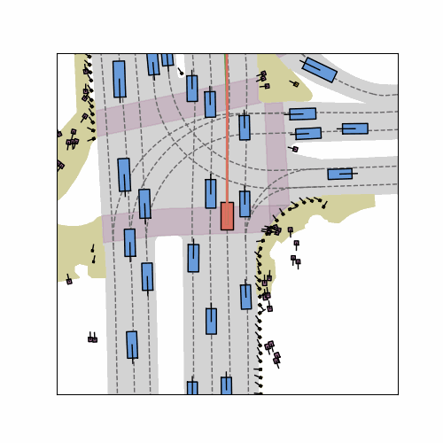

# navsim-diffusiondrive

我在消费级显卡（单/双 RTX 5070 Ti 16G）上把 DiffusionDrive（CVPR 2025 Highlight）在 NAVSIM 基准上完整跑了一遍，并且不止于跑通：把失败案例拆开看了一千多张图，试着用"错题加权"的思路去修，最后得到了一些论文里没有的认识——包括一个诚实的负结果。

## 结果一览

- 复现基线 **PDMS 88.07**（官方 88.1），navtest 全量 12146 场景零失败；同管线实测人类司机基线 94.55，比论文常引的 91 高不少，"超越人类"的门槛其实比想象中高
- 扩散步数扫描：**1 步推理 89 FPS 且不掉分**（官方默认 2 步 74 FPS），截断扩散"锚点已约束解空间"的论断在消费级硬件上成立
- 失败归因：排除 CSV 的 `average` 汇总行后，12146 个场景里碰撞扣分 224、驶出可行驶区域扣分 457、TTC 扣分 635。旧文的 225/458/636 误计了汇总行；人工查看的代表场景提示弯道／环岛几何控制值得重点排查，不能据此证明其占所有失败的比例。
- 错题加权微调：v1 掉分后调整学习率和轮数，v2 epoch02 的 **PDMS 87.90，比基线 88.07 低约 0.17 分**；修复了 16/224 个基线碰撞扣分场景，也新增 10 个，因此净减少 6 个。不将单次评测差值称为已验证的“噪声带内持平”。


## 思考

复现只是入场券，真正有意思的是后面两件事。

一是**失败不是均匀分布的**。光看 PDMS 总分你会觉得模型"哪里都差一点"，但把每个失败场景拉到鸟瞰图里看轨迹才发现，问题高度集中在弯道横向控制和路口让行上——这直接决定了微调该往哪个方向用力，也让我理解为什么行业里都在建"长尾场景库"而不是平均地收集数据。

二是**本次加权微调没有带来总体分数提升**。局部修复与新增失败并存，验证损失变化也有限；这不足以证明模仿学习已达理论上限，后续可考虑数据覆盖、目标函数、RL 后训练或世界模型等方向。

## 仓库内容

```
DiffusionDrive/              # hustvl/DiffusionDrive 的 fork，含三处本机适配补丁
                             #   （DD_STEP_NUM 步数可调、torch 2.8 调度器 API 修复、路径修正）
run_training_weighted.py     # 加权采样微调脚本（WeightedRandomSampler + 代理特征）
proxy_features.py            # 给 10.3 万训练场景自动打标（前车TTC/密度/转角/起步状态）
analyze_failures.py          # 从逐场景成绩单挖失败签名
failure_taxonomy.py          # 失败分类报告 + 代表场景挑选
render_scene.py / render_gif.py / render_cameras.py   # 鸟瞰图 / GIF / 相机可视化
measure_latency.py           # 推理延迟实测
scan_steps.sh                # 步数-精度扫描
run_eval.sh                  # 一键评测
blog/                        # 完整记录（草稿）+ 所有图
results/                     # 逐场景成绩单 CSV、失败分类报告、可视化产物
```

## 一些过程图

| 步数-延迟权衡 | 子项扣分分布 | 训练曲线（v1 的过拟合拐点在 epoch 4） |
|---|---|---|
|  |  |  |

失败场景鸟瞰对比（红=模型轨迹，绿=人类司机）：



## 复现指引

模型权重（729MB）和数据集（navtest 219GB / navtrain 302GB）不在仓库里，按 `download_all.sh` / `download_navtrain_local.sh` 拉取（国内网络已做镜像适配），权重从 [hustvl/DiffusionDrive](https://huggingface.co/hustvl/DiffusionDrive) 下载。环境：python 3.10 + torch 2.8.0+cu128（RTX 50 系必须），`source env.sh` 后 `bash run_eval.sh eval`。

### 2026-11-03 归档补全

之前仓库缺少 README 提及的加权训练脚本及 v1/v2 原始评测，现已补齐：7 组完整评测、85,022 条场景结果、103,288 条训练代理特征、训练事件、Hydra 配置和训练日志。独有微调权重在 `research-archive-2026-11-03` Release，原始数据按上游条款重新下载，不上传。

```bash
python3 verify_archive.py
```

[完整成绩与碰撞修复／新增统计](results/archive_summary.json) · [复现、权重与清理边界](REPRODUCE.md)。CSV 内的 `average` 行必须排除；碰撞扣分定义为 `NC < 1`，包括 `NC=0.5`。这两点避免了旧分析中的计数偏差。

## 参考

- DiffusionDrive: https://arxiv.org/abs/2411.15139 ｜ 代码: https://github.com/hustvl/DiffusionDrive
- NAVSIM: https://github.com/autonomousvision/navsim
- 上游代码与数据保留原始许可（见 DiffusionDrive/LICENSE）

*独立复现研究，与原作者无关。*
