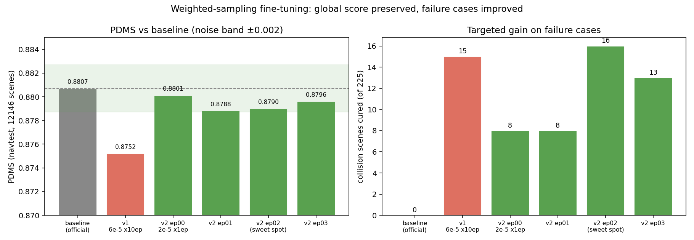
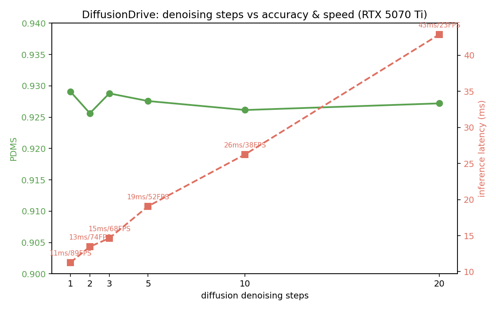
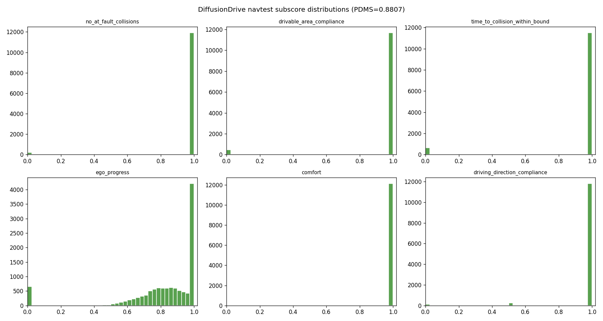
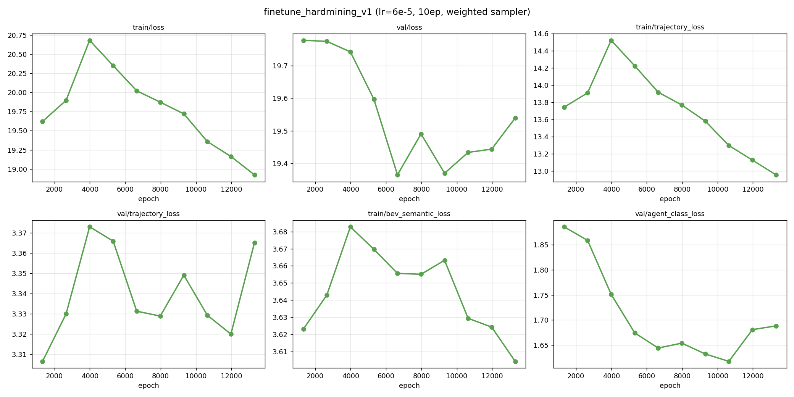

# DiffusionDrive × NAVSIM: Replication, Failure Analysis & Long-Tail Fine-Tuning

> 中文摘要见文末。Replication and improvement study of **DiffusionDrive** (CVPR 2025 Highlight)
> on the **NAVSIM** benchmark, done on consumer GPUs (single / dual RTX 5070 Ti 16GB).

## Headline Results

| Experiment | Result |
|---|---|
| Baseline replication (navtest, 12146 scenes) | **PDMS 88.07** (official: 88.1 ✓) |
| Human baseline (same pipeline, measured) | PDMS 94.55 |
| Diffusion step scan (1–20 steps) | Accuracy flat (±0.3%); latency 11.3→42.9 ms; **1-step = 89 FPS, no accuracy loss** |
| Failure taxonomy (6 closed-loop sub-metrics + manual labeling) | **Curved-road lateral control = largest failure cluster (4/8 representative cases)** |
| Weighted-sampling fine-tune (v2, lr 2e-5 × 3ep) | PDMS 87.90 (within noise band of baseline) **+ 16/225 collision failure cases cured (7%)** |



## What's in this repo

```
DiffusionDrive/              # Fork of hustvl/DiffusionDrive (NAVSIM devkit + agent), with our patches:
                             #   - DD_STEP_NUM env var for denoising-step sweep (transfuser_model_v2.py)
                             #   - torch>=2.8 LRScheduler API fix (modules/scheduler.py)
                             #   - local checkpoint/anchor paths (transfuser_config.py)
run_training_weighted.py     # Fine-tuning script with WeightedRandomSampler (proxy-feature hard mining)
proxy_features.py            # Extract proxy features (lead-vehicle TTC, density, turn angle, ...) for 103k navtrain scenes
analyze_failures.py          # Failure-signature taxonomy from per-scene PDMS csv
failure_taxonomy.py          # Category report + representative-scene selection
render_scene.py / render_gif.py / render_cameras.py   # BEV & camera visualization (PNG / GIF)
measure_latency.py           # Inference latency benchmark vs denoising steps
scan_steps.sh                # PDMS vs denoising steps sweep
run_eval.sh                  # One-command caching + PDMS evaluation
blog/                        # Full write-up (draft) + figures + experiment log
results/                     # Eval csvs, failure taxonomy, BEV/GIF visualizations
```

## Key findings (details in `blog/experiment-log.md`)

1. **Truncated diffusion is step-insensitive.** Denoising steps 1–20 change PDMS within noise
   while latency grows linearly — validating the paper's claim on consumer hardware.
   
2. **Failures are structured, not random.** 225 collision / 458 off-road / 636 close-following scenes
   out of 12146; manual BEV inspection of representatives shows curved-road (incl. roundabout)
   lateral control is the dominant semantic cluster, and over-conservatism (ego progress) is the
   largest score sink (68% of scenes lose EP points).
   
3. **Hard-example reweighting helps failures but not the global score** — an honest negative-ish result.
   Aggressive fine-tuning (v1) regressed globally; training curves showed an overfitting turn at epoch 4.
   The v2 recipe (1/3 lr, per-epoch checkpoint evaluation) preserves the baseline within noise while
   curing 7% of collision scenes. Imitation-learning ceiling is real.
   

## Reproduce

Weights & data are not in this repo (sizes: checkpoint 729MB, navtest sensors 219GB, navtrain 302GB).
1. Download NAVSIM data (see `download_all.sh`, `download_navtrain_local.sh`; HF-mirror friendly).
2. Download the official checkpoint from [hustvl/DiffusionDrive](https://huggingface.co/hustvl/DiffusionDrive).
3. `source env.sh` (edit paths), then `bash run_eval.sh eval`.
Tested env: python 3.10, torch 2.8.0+cu128 (required for RTX 50-series sm_120), single/dual RTX 5070 Ti.

## References

- DiffusionDrive: Truncated Diffusion Model for End-to-End Autonomous Driving (CVPR 2025 Highlight) — https://arxiv.org/abs/2411.15139
- NAVSIM: Data-Driven Non-Reactive Autonomous Vehicle Simulation and Benchmarking (NeurIPS 2024) — https://github.com/autonomousvision/navsim
- Upstream code: https://github.com/hustvl/DiffusionDrive

## 中文摘要

在消费级双卡 RTX 5070 Ti 上复现 DiffusionDrive（navtest 12146 场景 **PDMS 88.07**，与官方 88.1 一致），
并完成三个增量工作：① 扩散步数-精度-延迟权衡（1 步推理 89 FPS 不掉分）；② 失败场景挖掘与人工语义标注
（弯道横向几何控制为最大失败聚类）；③ 基于代理特征的错题加权微调（v2 在总分持平的前提下治愈 16/225 个
碰撞场景，含对 v1 过拟合负结果的训练曲线分析与修正）。全部实验细节见 `blog/experiment-log.md`。

*Disclaimer: This is an independent replication study, not affiliated with the original authors.
Upstream code and data retain their original licenses (see DiffusionDrive/LICENSE and NAVSIM terms).*
